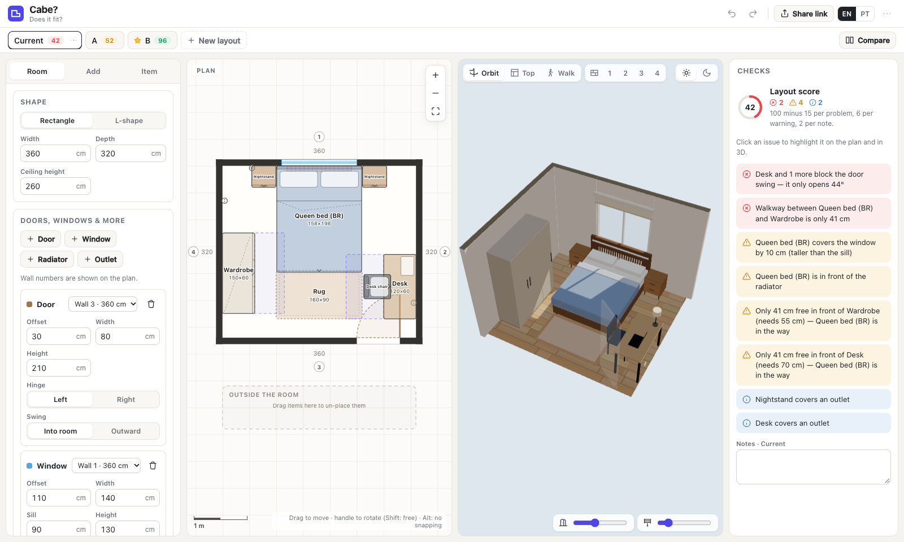

# Cabe? — does it fit?

A room planner that tells you whether your furniture actually fits. Draw the room, drop in furniture, and see it in a 2D plan and a synced 3D view while live checks flag problems and score the layout from 0 to 100.

*"Cabe?" is Brazilian Portuguese for "does it fit?"*

**[Try it live →](LIVE_URL)**



## What it does

- **Room**: rectangle or L-shape, with doors (hinge side, swing direction), windows, radiators and outlets on any wall.
- **Furniture**: Brazilian and US bed sizes, storage, desk, chair, sofa, rug and custom items. Every size and front clearance is editable.
- **2D plan**: drag, rotate, snap to walls and furniture, live distances to walls, pan/zoom/pinch, undo/redo.
- **3D view**: orbit, top-down, per-wall and first-person walk cameras (with collision), cutaway walls, day/evening lighting. The door opens only as far as the furniture lets it.
- **Live checks**: overlaps, items outside the room, blocked door swing and doorway, front clearance (wardrobe doors, desk chair), windows, radiators, outlets and narrow walkways. Click an issue to highlight it in both views.
- **Layouts**: several layouts per room, each with its own score, notes and a side-by-side compare.
- **Saving and sharing**: autosaves in the browser, JSON export/import and compressed share links. No account or server needed.
- **English and Portuguese**, on desktop and phone.

## How the checks work

The geometry is plain TypeScript with no UI code, so it's unit-tested and fast enough to score thousands of layouts.

- **Overlap** uses the Separating Axis Theorem on the real rotated rectangles. Rugs don't collide, and a chair can tuck under a desk.
- **Outside the room** checks corners *and* edge crossings, which catches furniture poking through the inner corner of an L-shaped room.
- **Door swing** finds furniture inside the quarter-circle the door sweeps, then opens the door 1° at a time to report how far it really gets.
- **Front clearance** binary-searches how much of the strip in front of each item is actually free.
- **Walkways** flag 25–60 cm gaps you'd have to walk *through*. Dead-end pockets are ignored.

## Tech

React 18 · TypeScript · three.js via React Three Fiber · Zustand · Vite · Vitest

The whole app builds into one self-contained `index.html`. The 3D view only renders when something changes, which keeps it light on older laptops.

## Run it locally

```bash
npm install
npm run dev      # http://localhost:5173
npm test         # geometry and check unit tests
npm run build    # → dist/index.html
```

## Roadmap

- Path-finding from the door to the bed and desk, instead of the current gap check
- "Biggest that fits": the largest bed or wardrobe a spot can take
- Auto-suggested layouts, ranked by score
- Importing a room scanned with a phone's LiDAR
